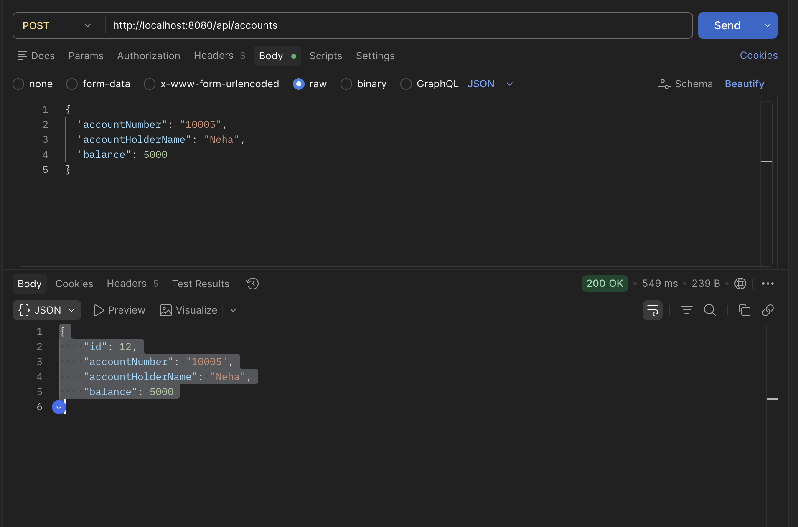
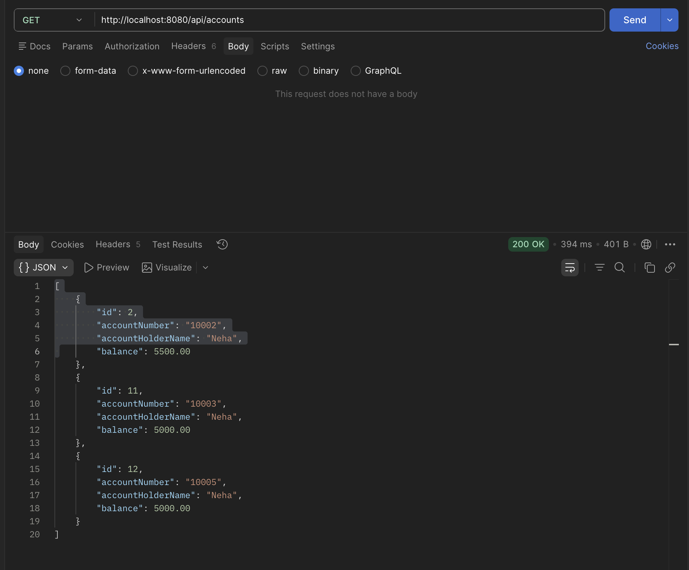
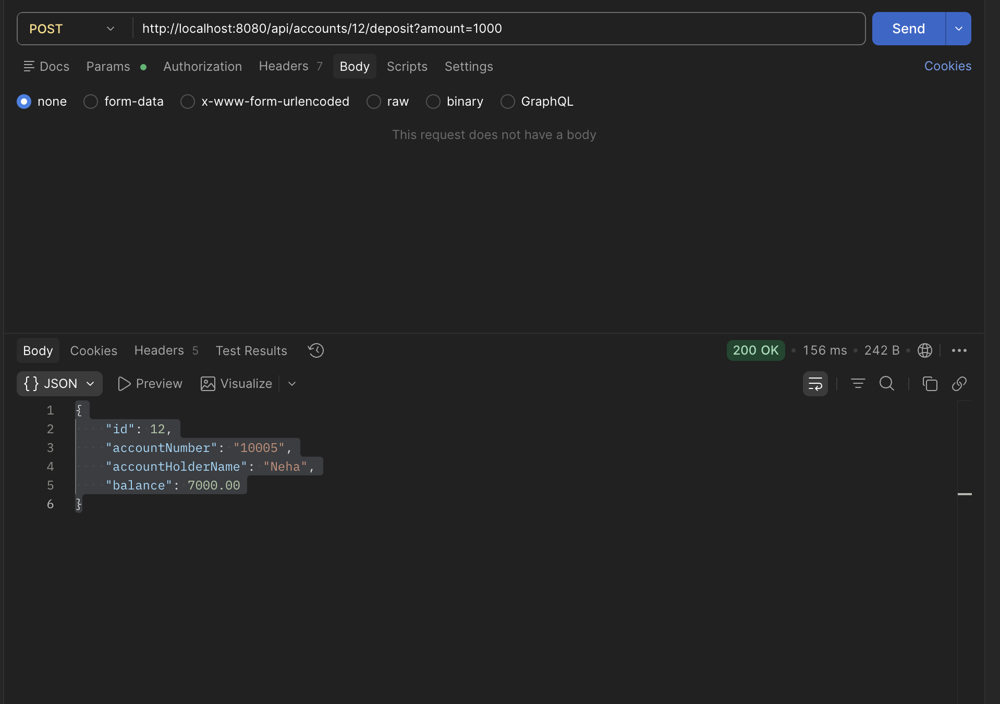
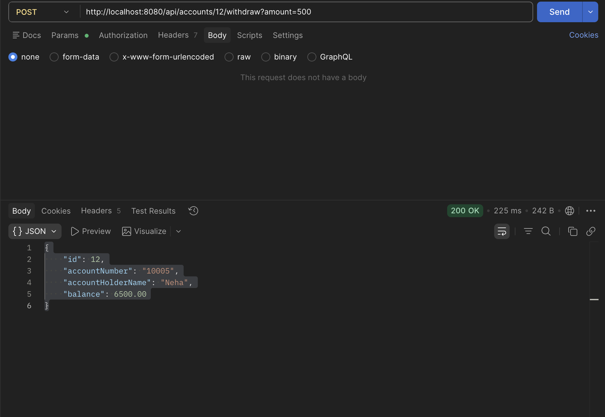

# Banking Management System

A RESTful Banking Management System developed using **Java, Spring Boot, Spring Data JPA, and MySQL**. This application provides APIs to manage bank accounts and perform basic banking operations such as account creation, balance enquiry, deposits, withdrawals, and account deletion.

## Technologies Used

- **Programming Language:** Java 17
- **Framework:** Spring Boot 3.5.7
- **Database:** MySQL
- **ORM:** Spring Data JPA / Hibernate
- **API:** RESTful Web Services
- **Build Tool:** Maven
- **IDE:** Eclipse
- **API Testing:** Postman
- **Version Control:** Git and GitHub

## Features

- Create a new bank account.
- View all bank accounts.
- Retrieve account details using account ID.
- Deposit money into an account.
- Withdraw money from an account.
- Validate account details and transaction amounts.
- Handle exceptions with appropriate HTTP status codes.
- Prevent withdrawals when the account has insufficient balance.
- Delete an existing bank account.

## Project Structure

```text
banking-management/
│
├── src/main/java/com/fujitsu/banking_management/
│   ├── controller/
│   │   └── AccountController.java
│   ├── dto/
│   │   ├── AccountRequest.java
│   │   └── AccountResponse.java
│   ├── entity/
│   │   └── Account.java
│   ├── exception/
│   │   ├── GlobalExceptionHandler.java
│   │   └── ResourceNotFoundException.java
│   ├── repository/
│   │   └── AccountRepository.java
│   ├── service/
│   │   └── AccountService.java
│   └── BankingManagementApplication.java
│
├── src/main/resources/
├── src/test/java/
├── pom.xml
└── .gitignore
```

## REST API Endpoints

Base URL: `http://localhost:8080/api/accounts`

| Method | Endpoint | Description |
|---|---|---|
| POST | `/api/accounts` | Create account |
| GET | `/api/accounts` | Get all accounts |
| GET | `/api/accounts/{id}` | Get account by ID |
| POST | `/api/accounts/{id}/deposit?amount=1000` | Deposit money |
| POST | `/api/accounts/{id}/withdraw?amount=500` | Withdraw money |
| DELETE | `/api/accounts/{id}` | Delete account |

## Sample Request

**Create Account**

```json
{
  "accountNumber": "10001",
  "accountHolderName": "John",
  "balance": 5000
}
```

## Database Configuration

1. Install and start MySQL.
2. Create a database:

```sql
CREATE DATABASE banking_db;
```

3. Configure your database connection using environment variables in `application.properties`:

```properties
spring.datasource.url=jdbc:mysql://localhost:3306/banking_db
spring.datasource.username=${DB_USERNAME}
spring.datasource.password=${DB_PASSWORD}

spring.jpa.hibernate.ddl-auto=update
spring.jpa.show-sql=true
```

Set `DB_USERNAME` and `DB_PASSWORD` in your local environment. Do not commit database credentials to GitHub.

## How to Run the Project

1. Clone the repository:

```bash
git clone https://github.com/Neha-Pandhare/banking-management-system.git
```

2. Open the project in Eclipse as an existing Maven project.

3. Configure the MySQL database credentials.

4. Update Maven dependencies.

5. Run `BankingManagementApplication.java` as a Java Application.

6. Test the REST APIs using Postman.

The application runs at:

`http://localhost:8080`

## Exception Handling

The application includes centralized exception handling using `@RestControllerAdvice`.

Examples:
- 400 Bad Request – Invalid input or insufficient balance.
- 404 Not Found – Account does not exist.

## Author

**Neha Pandhare**

Java Developer | Spring Boot | REST APIs | MySQL

GitHub: https://github.com/Neha-Pandhare

## API Testing Screenshots

The REST APIs were tested successfully using Postman.

### 1. Create Account


### 2. Get All Accounts


### 3. Deposit Money


### 4. Withdraw Money

